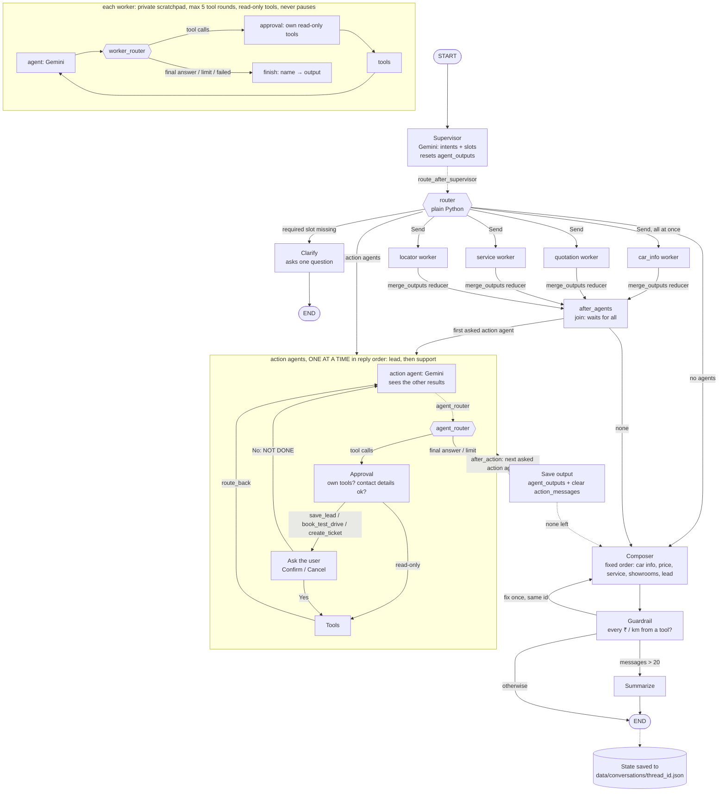

# Skoda India Customer Support Agent: Roadmap and Design

Status: **Phases 1–5 complete (Phase 5 as a local demo on 2026-10-22).** See section 1 for what each phase delivered and sections 7–13 for the changes since.

This file is the source of truth for the build. The graph follows the user's flowchart
(`Skoda-Agent-Flow.pdf`), node for node.

### Decisions
- Project root: this folder (same layout as `skoda-agent/`).
- Work one phase at a time, and **never start a phase or new work without the user's explicit go-ahead**.
- Required details per agent live in each agent file (section 8). Since 2026-10-22 a price needs only the model: without a variant or city the bot shows the price list instead of asking (section 14).
- `data/raw/` starts with sample docs marked SAMPLE. Real brochures are added later and the index is rebuilt.
- Seed data is real public data, with a source on every row (see `data/seed/README.md`).
- Python 3.14 venv. `langchain-community` is not used (it is being sunset); FAISS is used directly.
- "Ask the user" is its own node. The Gemini call happens inside each agent node.
- The small State writes the flowchart doesn't show are kept: the per-turn reset, and the guardrail feedback and retries.
- If the guardrail's one fix still fails, the reply is replaced with a safe callback message.
- **2026-10-21: parallel agents (option A), approved and built.** The non-action agents run in parallel instead of the flowchart's sequential queue; the action agents (lead, support) run after them, one at a time. This deliberately changes the flowchart. Sections 3–5 describe the parallel design; the reasons and decisions are in [section 7](#7-change-log-parallel-agents-option-a-built-2026-10-21).

---

## 1. Roadmap

Each phase ends with a check the user can run. Claude stops after every phase and waits for the go-ahead.

### Phase 1: Scaffold, seed data, schemas, repository ✅ done
- Folder structure, pinned `requirements.txt`, `.env.example`, `.gitignore`, `pytest.ini`.
- `app/config.py` (pydantic-settings), `app/data/schemas.py`, `app/data/repository.py`, `app/log.py` (structlog with phone masking).
- Real seed data in `data/seed/` (8 files) with sources, documented in `data/seed/README.md`.
- 17 tests passing (`tests/test_repository.py`, `tests/test_log.py`).

**Check:** `python -m app.data.repository` and `pytest -q`.

### Phase 2: Ingestion and FAISS retrieval ✅ done
- **Embedding model:** `gemini-embedding-2` (the current recommendation in the Gemini docs), 768 dims. It takes no `task_type`; documents are embedded as `title: <section> | text: <chunk>` and queries as `task: search result | query: <q>`. Vectors are L2-normalised, so FAISS inner product = cosine similarity.
- `ingestion/loaders.py`: PDF (pypdf, page numbers kept), HTML (bs4, scripts/nav stripped, headings and tables kept), Markdown/TXT (`<!-- comments -->` not indexed). Folder = `doc_type` (`data/raw/<brochure|specs|faq|service|warranty>/`); a file-name prefix = model id, otherwise `all`.
- `ingestion/chunker.py`: chunks never cross a heading; tables are never split; long sections split at paragraph/sentence boundaries with overlap (`CHUNK_MAX_CHARS=1500`, `CHUNK_OVERLAP_CHARS=200`); each chunk starts with its heading path.
- `app/tools/retrieval.py`: `Chunk`, `save_index`, `VectorStore.load` (refuses a changed embedding model/dimension or a broken index) and `VectorStore.search` (top-k, `min_score`, model and doc-type filters applied inside FAISS with `IDSelectorBatch`).
- `data/index/`: `index.faiss` (vectors), `chunks.json` (text + metadata), `manifest.json` (model, dimension, sources with sha256).
- 13 SAMPLE docs in `data/raw/` (5 brochures, 5 spec sheets, warranty, service FAQ, general FAQ) → 51 chunks. No prices in documents.
- `RETRIEVAL_SCORE_THRESHOLD` tuned to **0.62**: off-topic questions scored ≤ 0.58, relevant ones ≥ 0.67.
- 20 new tests (`tests/test_ingestion.py`, offline with fake embeddings); 37 tests in total.

**Check:** `python -m ingestion.build_index`, then `python -m ingestion.test_retrieval` (add `--all` to see scores below the threshold).

### Phase 3: Tools (all 11) ✅ done
- `calculators.py` (pure maths, whole rupees rounded half-up): on-road price = ex-showroom + road tax (state/fuel/band) + cess (% of tax and/or flat) + registration + HSRP + insurance + TCS (1% only when ex-showroom > ₹10 lakh) + FASTag + handling + chosen accessories; range = mileage × tank (EV: claimed range); service cost = scheduled visits within N years; haversine distance.
- `common.py`: `returns_errors_as_text` (no tool ever raises), JSON output, model/variant resolution that lists the options when nothing matches.
- `data_tools.py`: `get_variant_details`, `calculate_on_road_price`, `calculate_range`, `get_service_cost`, `get_service_schedule`.
- `geo_tools.py`: `geocode_location` (GPS → cache → Nominatim at ≤1 req/s → pincodes.csv; area, pincode or city centre) and `find_nearest_dealers` (haversine, type filter, Google Maps link, coverage note beyond 50 km).
- `retrieval.py`: `search_brochures` (brochure/specs/faq) and `search_service_docs` (service/warranty/faq); model filter `[model, "all"]`; `NO_RESULTS` text below the threshold.
- `lead_tools.py`: `save_lead`, `book_test_drive` → `data/leads.csv`. Phone normalised to a 10-digit Indian mobile; masked in the tool result; CSV formula injection neutralised; test drives only for on-sale models, dates today to +60 days, dealer must be a showroom.
- `registry.py`: `TOOLS_BY_AGENT`, `ALL_TOOLS`, `TOOLS_REQUIRING_APPROVAL`.
- Checked against the data: Kylaq Signature AT, Hyderabad = ₹12,92,125; Kylaq AT 3-year service = ₹18,996 and MT 5-year = ₹37,662 (matching V3Cars' totals).
- Known gap: the city → state lookup only knows cities in `pincodes.csv` / `dealers.csv`; for other cities (e.g. Pune) the tool asks for the state. Road tax exists only for Telangana, Karnataka, Maharashtra and Delhi.
- 46 new tests (`test_calculators.py`, `test_tools.py`); 83 in total, offline.

**Check:** `pytest -q`.

### Phase 4: LangGraph graph ✅ done
- Built as designed in sections 2–5: `app/graph/state.py`, `app/graph/nodes/*` (supervisor, router, clarify, agent_factory, save_output, approval + ask_user, composer, guardrail, summarize), `app/agents/*`, `app/prompts/*`, `app/llm.py`, `app/graph/build_graph.py`, `app/memory/file_store.py`, `app/cli.py`.
- `python -m app.graph.build_graph` writes `docs/graph.md` (Mermaid generated from the compiled graph); `recursion_limit` = 126.
- Extra safety: the approval node refuses a tool that isn't in the calling agent's own list (it never reaches ToolNode).
- Tool change: `get_service_cost` and `get_service_schedule` also return `cumulative_cost_by_year`, so the service agent can answer "cost for N years" without adding numbers itself.
- Data fix: `variant_features.csv` now replaces superseded lower-trim items (1,372 → 1,221 rows).
- Environment: `ormsgpack` pinned to 1.12.2 because Windows Application Control blocks 1.13.0's compiled module on this machine.
- 32 new graph tests with scripted fake LLMs (`tests/test_graph.py`); 115 tests in total. Live run of all spec example conversations against Gemini passed (guardrail passed first time on each; complex turns take 15–30 s).
- 2026-10-21: the sequential queue was replaced by parallel agents (section 7); the original plan below describes the first build.

Original plan:
1. `state.py`; `llm.py` (one Gemini instance per role, with timeout and retries).
2. `supervisor.py`: `RouterOutput`, `INTENT_TO_AGENT`, `REQUIRED_SLOTS`, `build_queue`, slot merge (including `name` and `phone`).
3. `router.py`: `next_step`, `agent_router`, `route_back`, `after_guardrail`.
4. `clarify`, `agent_factory` and the 5 agents, `save_output`, `approval`, `ask_user` (interrupt/resume), `ToolNode`, `composer`, `guardrail`, `summarize`.
5. `app/prompts/`: one prompt file per node.
6. `build_graph.py`: compile with `MemorySaver`, compute `recursion_limit`, export a Mermaid diagram to `docs/graph.md`.
7. `app/memory/file_store.py`: save and restore State as JSON.
8. Add `MAX_TOOL_ROUNDS=5` to `config.py` and `.env.example`.
9. Tests: `build_queue` (lead last), `next_step`, `agent_router` (including the tool-round cap), guardrail number check, composer replace-by-id, conversation save/load, and the approval flow (pause → Confirm runs the tool; Cancel adds NOT DONE and returns to the agent) using a fake LLM.
10. CLI script to chat with the graph in the terminal.

**Check:** `pytest -q`, then the CLI chat against real Gemini.

### Phase 5: API and UI ✅ local demo built (2026-10-22)
- **Decisions (user):** a **web page served by the API** instead of Streamlit (Windows Application Control blocks pyarrow, which Streamlit needs); **local demo first** (login, rate limiting, strict CORS and HTTPS before any internet deployment); **progress updates** over Server-Sent Events.
- `app/api/main.py` (FastAPI, `create_app(graph=None)`): `POST /api/chat` `{thread_id?, message (≤2,000 chars), lat?, long? (India only)}` and `POST /api/resume` `{thread_id, approved, feedback?}` stream `thread` → `status`… → `reply` | `confirm` | `error` → `done`. Each turn runs through `run_turn` in a worker thread (one turn at a time per conversation), restores the thread from its JSON if needed, and saves the State at every turn end (design rules 2 and 3: only progress is streamed, the reply after the guardrail). A shared location becomes the `lat`/`long` slots. `GET /api/threads/{id}` (messages + any pending Confirm), `GET /api/health`, `/` serves the page. Thread ids validated; resume without a pause → 409; errors → the friendly message only. Logs: `data/logs/api.log`.
- `ui/index.html`: chat bubbles, progress line, replies rendered from Markdown and sanitised (marked + DOMPurify), Confirm/Cancel card with an optional note, Share location, New chat, conversation restored after a refresh.
- `app/graph/progress.py`: the progress texts, shared by the CLI and the API. `tests/test_api.py` (8 tests); 214 tests pass. Live check over HTTP: "Nearest Skoda showroom to Kukatpally" streamed status events then the reply.

Original plan:
1. FastAPI `POST /chat` (streams progress events; the reply is sent only after the guardrail) and `POST /resume`.
2. State saved to `data/conversations/{thread_id}.json` at every turn end (see design rule 3).
3. Streamlit chat: share my location, continue by thread_id, Confirm / Cancel when the graph pauses.

**Check:** run the API and UI and go through the example conversations by hand.

### Phase 6: Evals, tracing, README
1. ✅ `evals/test_questions.jsonl`: 48 cases (every intent, follow-ups, multi-intent, clarify, Confirm/Cancel, refusals) with expected intents, agents, slots, tools, sources and key facts.
2. ✅ `evals/run_evals.py` + `metrics.py` + `judge.py`: routing, slot, tool-use and flow accuracy, retrieval hit@k, key-fact correctness, faithfulness (LLM judge), refused-correctly rate, latency. See [evals/README.md](evals/README.md). Each case costs ~5–7 Gemini calls, so run a few cases with `--only` (or `--no-judge`) rather than the whole set. Last run (2026-10-19, 7 cases): 100% on every metric, latency median 14.6 s.
3. ✅ Observability (2026-10-20, `app/observability.py`):
   - **Turn logs, always on, local:** `run_turn` binds `turn_id` + `thread_id` to every log line of the turn (also inside LangGraph's worker threads) and ends with one `"turn"` line: status (reply/paused/error), resumed, total seconds, nodes in order, seconds per node, intents, agents, tools, filled slot *names*, clarify, guardrail (ok/retried/safe_reply), Gemini calls/retries/seconds/input/output/thinking/cached tokens, embedding calls/cache hits, `awaiting` (paused) or `error` type. No message text or slot values. Counters come from `LoggedLLM` and `VectorStore.query_vector` through a context variable.
   - **LangSmith, optional:** `LANGSMITH_TRACING=true` + `LANGSMITH_API_KEY` (+ optional `LANGSMITH_PROJECT`, `LANGSMITH_ENDPOINT`). The CLI passes one `LangChainTracer` in the run config whose `Client(anonymizer=mask_trace)` masks phone numbers in every input, output and error before sending; names and other text are sent as is. Shell variables (`LANGSMITH_TRACING`, `LANGCHAIN_TRACING_V2`) are forced to false so the SDK never auto-traces unmasked. Traces are flushed on exit. Evals are never traced.
4. ✅ [README.md](README.md) (2026-10-21): what it does, how it works, setup, running (CLI, Studio), tests and evals, layout, extending, privacy, known limits.

**Check:** `python -m evals.run_evals --only <ids>` prints a score report.

---

## 2. Design rules (final)

1. **Composer retry replaces the reply.** When the guardrail sends the reply back, the composer reuses the message id of the reply it is fixing (the last AIMessage in `messages`). `add_messages` then replaces that reply instead of adding a second one. The guardrail's safe callback reply reuses the same id too.
2. **No unchecked text reaches the UI.** `/chat` streams only progress status events (for example "Checking prices…", "Finding showrooms…"), built from node updates. The reply text is read from the final State and sent only after the graph stops. Composer tokens are never streamed.
3. **State is saved at every turn end.** The API saves the full State to `data/conversations/{thread_id}.json` whenever a run stops:
   - after `clarify → END`,
   - after the main END (guardrail → END or summarize → END),
   - when the graph pauses at `ask_user` (and again when `/resume` finishes).

   If a thread_id isn't in MemorySaver (for example after a restart), the JSON is restored with `graph.update_state()` before streaming. Limitation: a pause at `ask_user` can't be resumed after a restart. The pending action is dropped, the UI asks the customer to repeat the request, and the next turn's per-turn reset clears the scratchpad.
4. **At most `MAX_TOOL_ROUNDS` (default 5, set in `.env`) tool rounds per agent.** A tool round is one AIMessage with tool calls in that agent's scratchpad (a worker's `scratch`, or `action_messages`). If the agent asks for tools again after 5 rounds, its router sends it to `finish` (workers) or `save_output` (lead) instead of `approval`, which stores a short "Sorry, I couldn't complete this part of your request" answer, plus the tool results gathered so far, with `status: "incomplete"`. The composer tells the customer and offers a callback.
   **Recursion limit:** the main graph's longest turn is supervisor, the parallel group (one step, however many agents), after_agents, composer ×2, guardrail ×2, summarize and one spare, plus every action agent's loop (at most 4 steps per tool round: agent, approval, ask_user, tools; plus its final step and save_output): `recursion_limit = 9 + action agents × (4 × MAX_TOOL_ROUNDS + 2) + 10 margin` = **63** with two action agents. Each worker counts its own steps (3 per round + final agent + finish = 17). Computed in `build_graph.py` from the config and the catalog.
5. **`name` and `phone` are slots.** `RouterOutput` and `slots` include them. The supervisor prompt says: *if the last assistant message asked for contact details, classify the reply as `lead_capture` and extract `name` and `phone`*. In Python, the supervisor normalises the phone to 10 digits (stripping +91/0) and drops an invalid one, so the lead agent asks again. Phone numbers stay masked everywhere they could leak: the structlog processor masks every log field (including logged slots and tool args), and LangSmith traces use an anonymizer with the same pattern. They are stored unmasked only in `data/leads.csv` and `data/conversations/`, both gitignored.
6. **Per-turn reset.** At the start of each question the supervisor resets `agent_outputs` (it writes `None`, which the `merge_outputs` reducer turns into `{}`), clears `action_messages` and `active_action` (workers always start with an empty private scratchpad), and sets `guardrail_feedback = None` and `guardrail_retries = 0`.
7. **Guardrail number matching.** Figures are normalised before comparing: Indian commas (₹12,34,567), "₹12.35 lakh" / "crore", and km with decimals. Rounding of up to 0.5% is allowed for lakh-style figures.
8. **Retrieval answers only from returned text.** A high similarity score means "on topic", not "the answer is here" (e.g. "Slavia boot space" scores 0.75 against the spec table, but boot space isn't in the documents). The car_info and service agent prompts must say: answer only from the returned chunks, cite the source, and say "I don't have that information" when the chunks don't contain the answer. Search calls always pass the model filter as `[model, "all"]`.
   - **Hybrid search** (added 2026-10-20, `RETRIEVAL_MODE=hybrid`, default): the best `RETRIEVAL_CANDIDATES` vector hits (cosine ≥ the threshold) and the best BM25 keyword hits (`app/tools/keyword_search.py`, built in memory from `chunks.json`, light plural/accent folding, a small synonym list at half weight, hits below 50% of the best keyword score ignored) are merged with **Reciprocal Rank Fusion**: score = Σ 1/(`RETRIEVAL_RRF_K` + rank), k = 60. The vector threshold still decides whether the question is on topic: no chunk ≥ 0.62 in meaning → `NO_RESULTS`, even if words match. `score` in results stays the cosine; hits also carry `vector_rank`, `keyword_rank` and `rrf`. `RETRIEVAL_MODE=vector` restores embeddings-only search. No index rebuild needed.
   - **Query rewrite is done by the agent**, with no extra Gemini call: the car_info/service prompts and the search tools' `query` description tell the agent to write a short standalone query (resolve "it"/"its"/follow-ups from the conversation, keep exact terms, add the common synonym, one topic per query, one search per part).
9. **Gemini reliability** (added 2026-10-19 after a `504 DEADLINE_EXCEEDED` in the lead flow).
   - Root cause: the supervisor's JSON-schema structured output intermittently degenerated (`"phone": "1234567890\n\n\n…"` until the server's 60 s deadline). The supervisor now uses **function-calling** structured output, and every node has an **output-token cap** (`NODE_MAX_OUTPUT_TOKENS` in `app/llm.py`, plus its thinking budget), so a runaway generation stops in seconds.
   - **Thinking budget per node** in `.env` (`<NODE>_THINKING_BUDGET`): 0 for supervisor/clarify/summarize, 512 for agents and the composer (lowered from 2048 on 2026-10-20: the composer was the slowest, most expensive call; its output cap is 2048 and its prompt asks for concise replies). `gemini-2.5-pro` is raised to its 128 minimum; Gemini 3 maps to `thinking_level`. `SUPERVISOR_MODEL`/`CLARIFY_MODEL=gemini-2.5-flash-lite` is a documented cheaper option (default stays `gemini-2.5-flash`).
   - **Every Gemini call is logged** by `LoggedLLM`: node, model, request size (chars, approx tokens), elapsed time, input/output/thinking/cached-input tokens, finish reason; failures and retries too. Query embeddings are logged too (`cached`, elapsed) and kept in an in-memory cache (`VectorStore.query_vector`, 512 entries, key ignores case/spaces), so a repeated search makes no embedding call. Phone numbers are masked (also inside tracebacks).
   - **Retries:** the SDK's own retries are off; `LoggedLLM` retries only transient errors (timeouts, 429, 5xx, DEADLINE_EXCEEDED) up to `LLM_MAX_RETRIES`, waiting `LLM_RETRY_BASE_DELAY_S` × 2ⁿ (capped at `LLM_RETRY_MAX_DELAY_S`); then `LLMUnavailableError`.
   - **Safe failure:** `app/graph/runner.py` `run_turn()` (used by the CLI and the Phase 5 API) catches any failure, logs it, **rolls the thread back to its pre-turn State**, and returns "Sorry, I'm having trouble right now. Please try again in a moment." The CLI writes logs to `data/logs/app.log` (gitignored) unless `--verbose`.
   - **Trimmed context:** supervisor sees the last 6 messages, agents/composer the last 4; earlier assistant replies are clipped (600/800 chars), the summary is capped at 1,200 chars, each tool result in the composer prompt at 6,000 chars (the guardrail still checks the full results), `RETRIEVAL_TOP_K` = 4.
   - **Summarize** (fixed 2026-10-21, found in a live chat): it sent Gemini only a system message, which Gemini rejects (`contents are required`), so every turn of a conversation past 20 messages failed. The transcript now goes as a normal message after the instructions. If summarizing still fails, or comes back empty, the turn doesn't fail: the reply is already written and checked, so the messages are kept and summarizing is retried next turn. Verified live.
   - **Invalid contact details never reach Confirm/Cancel:** the approval node runs the lead tools' `contact_problem()` check first and sends problems back to the agent.

---

## 3. State (`app/graph/state.py`)

```python
def merge_outputs(old: dict | None, new: dict | None) -> dict:
    """Each agent adds its own entry; None (written by the supervisor or a rollback) resets to {}."""
    return {} if new is None else {**(old or {}), **new}


class State(TypedDict, total=False):
    # Customer chat only: HumanMessages, clarify questions, composer replies.
    # Reducer add_messages: appends; same id replaces; RemoveMessage deletes.
    messages: Annotated[list, add_messages]

    # Gemini's labels for the current question. No reducer: replaced every turn by supervisor.
    intents: list[str]

    # model, variant, fuel, transmission, city, state, area_or_pincode, lat, long, name, phone.
    # No reducer: supervisor merges old + new in Python (new non-null values overwrite).
    slots: dict

    # Scratchpad of the action agent now running (lead, support): tool-call AIMessages + ToolMessages.
    # Action agents take turns, so one is enough. Reducer add_messages; cleared by save_output and the reset.
    action_messages: Annotated[list, add_messages]

    # Which action agent is running, so approval / ask_user / tools return to it. "" when none.
    active_action: str

    # {agent: {"answer": str, "tool_results": [{"tool", "args", "content"}],
    #          "status": "complete" | "incomplete" | "failed", "seconds": float}}
    # Reducer merge_outputs: each agent adds only its own entry, so parallel agents never overwrite each other.
    agent_outputs: Annotated[dict, merge_outputs]

    # Set by guardrail when the composer must fix the reply; None otherwise. No reducer.
    guardrail_feedback: str | None

    # 0 or 1 within a turn. No reducer: guardrail increments, supervisor resets to 0.
    guardrail_retries: int

    # Summary of older messages. No reducer: summarize replaces it.
    summary: str


class WorkerState(TypedDict, total=False):   # private to each parallel worker subgraph
    agent: str
    dialogue: list                          # recent customer/assistant messages, copied in by Send
    known_slots: dict
    conversation_summary: str
    started: float                          # when the router started this worker (its own timer)
    scratch: Annotated[list, add_messages]  # this worker's tool requests + ToolMessages
    error: str | None                       # Gemini unavailable after all retries
    agent_outputs: Annotated[dict, merge_outputs]   # the ONLY key returned to the main graph
```

Each worker subgraph is compiled with `output_schema = {agent_outputs}`, and its other keys are named differently from State on purpose: two parallel workers writing the same non-reducer key (e.g. `slots`) in one step would be an error. The tool-round count is derived from the scratchpad, so it needs no extra field. System messages and tool lists are added only to each Gemini request and are never saved in State.

Conversations saved by earlier versions (with `queue`, `active_agent`, `agent_messages` or `lead_messages`) still load: unknown keys are ignored.

---

## 4. Graph

### Nodes
| Node | Gemini? | Reads | Writes |
|---|---|---|---|
| supervisor | yes, structured `RouterOutput` | messages, slots, summary | intents, slots (merged), per-turn reset |
| clarify | yes, no tools | intents, slots, messages | messages (+1 question) |
| car_info / quotation / service / locator | yes, own tools only | its `Send` input (recent dialogue, slots, summary) | **worker subgraph:** agent → worker_router → approval → tools → agent … (max `MAX_TOOL_ROUNDS`) → finish; returns only `agent_outputs[name]` |
| after_agents | no | — | nothing: the join; runs once, after every parallel agent has finished |
| lead, support (action agents) | yes, own tools only | messages (recent), slots, summary, action_messages, the other agents' `agent_outputs` | action_messages (+AIMessage), active_action |
| save_output | no | action_messages, active_action | `agent_outputs[active_action]` (answer + tool results + status), action_messages (cleared) |
| approval | no | action_messages, active_action | `Command(goto=tools / ask_user / active_action)` |
| ask_user | no (`interrupt()`) | action_messages, active_action | yes: `Command(goto="tools")`; no: `Command(goto=active_action, update={action_messages: NOT DONE…})` |
| tools | no (`ToolNode(all action agents' tools, messages_key="action_messages")`; approval already refused anything not the active agent's own) | action_messages | action_messages (+ToolMessages) |
| composer | yes, no tools | agent_outputs (in a fixed order), messages, slots, guardrail_feedback | messages (reply; on a fix it reuses the previous reply's id) |
| guardrail | no | messages[-1], agent_outputs, guardrail_retries | guardrail_feedback, guardrail_retries, or the safe reply (same id) |
| summarize | yes, no tools | messages, summary | summary, messages (RemoveMessage for older ones) |

**Inside a worker** (`app/graph/nodes/worker.py`): `approval` only lets the agent's own read-only tools run (anything else gets a NOT DONE ToolMessage; workers never pause); `tools` is a `ToolNode` over the agent's own tools with `messages_key="scratch"`; `finish` turns the scratchpad into `{answer, tool_results, status, seconds}`. If Gemini is still unavailable after all retries, the agent step records the error and `finish` returns `status: "failed"`; the other workers carry on.

### Edge list
**Normal edges**
| From | To |
|---|---|
| START | supervisor |
| clarify | END |
| car_info, quotation, service, locator | after_agents |
| composer | guardrail |
| summarize | END |

**Conditional edges** (plain Python: they only read State, never call Gemini, never write State)
| From | Function | Checks → goes to |
|---|---|---|
| supervisor | `route_after_supervisor` | 1. A `REQUIRED_SLOTS` value is empty for any intent (quotation: model, variant, city; locator: area_or_pincode **or** city **or** lat+long) → `clarify`, and no agent runs<br>2. Parallel agents asked → `[Send(agent, worker_input), …]`, all at once<br>3. Only action agents asked → the first one<br>4. No agents (small talk, out of scope) → `composer` |
| after_agents | `after_agents` | the first asked action agent (reply order) → it; otherwise → `composer` |
| save_output | `after_action` | the next asked action agent after `active_action` → it; otherwise → `composer` |
| tools | `route_back` | → `active_action` |
| lead, support | `agent_router` | last AIMessage has tool calls **and** tool rounds ≤ `MAX_TOOL_ROUNDS` → `approval`<br>tool calls **and** rounds > `MAX_TOOL_ROUNDS` → `save_output` (incomplete)<br>no tool calls → `save_output` |
| guardrail | `after_guardrail` | `guardrail_feedback` is set → `composer` (fix once)<br>otherwise `len(messages) > 20` → `summarize`<br>otherwise → END |

**Command routing**
| From | Checks → goes to |
|---|---|
| approval | a tool that isn't the active agent's own → NOT DONE → `active_action`; invalid contact details → NOT DONE → `active_action`; any action tool (`save_lead`, `book_test_drive`, `create_ticket`) → `ask_user`; otherwise → `tools` |
| ask_user | `interrupt({tool, details})`; on resume: yes → `tools`; no → a "NOT DONE" ToolMessage for each requested tool (plus feedback as a HumanMessage) → `active_action` |

**Guardrail outcomes**
| Situation | Guardrail writes | Next |
|---|---|---|
| all ₹ / km figures match tool results | `guardrail_feedback = None` | summary check |
| mismatch, `guardrail_retries == 0` | feedback naming the bad numbers, `guardrail_retries = 1` | composer (reuses reply id) |
| mismatch, `guardrail_retries == 1` | safe callback reply (same id), `guardrail_feedback = None` | summary check |

### Mermaid diagram

Solid arrows are normal edges and Command routing; dotted arrows are conditional edges. `docs/graph.md` has the diagram generated from the compiled graph.

---

## 5. Run-time flow

0. A request arrives as `stream(input, thread_id)` with `recursion_limit` set. If MemorySaver doesn't have the thread, restore it from `data/conversations/{thread_id}.json`.
1. **User question**: added to `messages` as a HumanMessage.
2. **Supervisor**: Gemini returns intents and slots (including name/phone when a contact-details question was just asked). Python merges the slots and resets the per-turn fields.
3. **Router** (`route_after_supervisor`): any required slot missing → clarify → END → State saved → question sent to the UI. Otherwise intents → agents; every non-lead agent is started **at the same time** with `Send` (each gets the recent messages, slots and summary); only lead → lead; no agents → composer.
4. **Workers, in parallel**: each loops agent → Gemini → tool request → approval (own read-only tools) → tools (Python, all maths) → agent, in its own scratchpad, until a final answer, the tool-round limit or a Gemini failure; then `finish` returns its entry.
5. **Merge and join**: `merge_outputs` adds every worker's entry to `agent_outputs`; `after_agents` runs once, when the slowest worker has finished.
6. **Action agents** (if asked), **one at a time in reply order** (lead, then support): each one's prompt also has the other agents' compact findings (e.g. the nearest showroom's `dealer_id`). Gemini → tool request → approval (own tools, contact details checked) → **ask_user**: pause → State saved → UI shows Confirm / Cancel → `/resume`: yes → tools; no → NOT DONE → the agent. **Save output** adds its entry and clears `action_messages`; `after_action` starts the next asked action agent (its own Confirm), else the composer. Finished results stay in State during a pause and are not run again.
7. **Composer**: one reply from all of `agent_outputs`, in the fixed order (quote table marked as an estimate with as-of date and source; showrooms by distance with Maps links; a failed part is named briefly).
8. **Guardrail**: pass → summary check; first mismatch → composer fixes it (same id); second mismatch → safe callback reply.
9. **Summary check**: more than 20 messages → summarize → END; otherwise → END. State saved → the checked reply is sent to the UI.

### Example routes
| Question | Path |
|---|---|
| "What safety features does the Kushaq have?" | supervisor → car_info worker → after_agents → composer → guardrail → END |
| "On-road price of Kylaq Signature AT in Hyderabad" | supervisor → quotation worker (tool loop) → after_agents → composer → guardrail → END |
| "Price of Slavia" | supervisor → clarify ("Which variant, and which city?") → END |
| "Kylaq Signature AT price in Hyderabad and nearest showroom to Madhapur" | supervisor → **quotation ∥ locator** → after_agents → composer → guardrail → END |
| "Service cost for Kodiaq for 3 years and book a test drive" | supervisor → service worker → after_agents → lead → approval → ask_user (pause) → Confirm → tools → lead → save_output → composer |
| "Hi!" / "Who will win the IPL?" | supervisor → composer (direct reply / polite refusal) → END |
| "What about the AT version?" after a Kylaq quote | supervisor (transmission = AT; model and city kept) → quotation worker → composer |
| "Ravi, 98xxxxxx10" after the bot asked for contact details | supervisor (lead_capture, or support_request if it was for a complaint; name, phone extracted) → that action agent → approval → ask_user |
| "My Kushaq's AC stopped after the service. Asha, 91xxxxxx80, Hyderabad" | supervisor (support_request) → support → approval → ask_user (pause) → Confirm → create_ticket → save_output → composer (ticket number) |
| "Book a Kylaq test drive and I want to complain about my Kushaq" | supervisor → lead (Confirm #1) → save_output → support (Confirm #2) → save_output → composer |

---

## 6. Data files (`data/seed/`)

Real public data compiled on 2026-10-17; every row has a source. Full sources, gaps and assumptions are in `data/seed/README.md`.

| File | Columns | Validation |
|---|---|---|
| `models.json` | id, name, body_type, segment, launch_year, is_ev, status (on_sale/upcoming/discontinued), notes | unique id |
| `variants.csv` | id, model_id, name, fuel, transmission (MT/AT/DSG), engine_cc, power_ps, torque_nm, mileage_kmpl, battery_kwh, claimed_range_km, fuel_tank_l, ex_showroom_price, price_city, price_as_of, source_url, spec_source_url | model_id exists; ICE needs engine_cc; EV needs battery + range; unique model+trim+transmission |
| `variant_features.csv` | variant_id, category, feature, source_url | variant_id exists |
| `rto_rates.csv` | state, fuel, price_band_min, price_band_max, rate_percent, cess_percent_of_tax, flat_cess, source_url, as_of | min < max; no overlapping bands per state+fuel |
| `service_schedule.csv` | model_id, fuel, transmission, interval_km, interval_months, service_type, est_cost_min, est_cost_max, as_of, source_url | model_id exists; min ≤ max |
| `dealers.csv` | id, name, type (showroom/service/both), address, city, state, pincode, phone, timings, services_offered, latitude, longitude, source_url, as_of | 6-digit pincode; lat/long inside India |
| `pincodes.csv` | pincode, area, city, state, latitude, longitude | 6-digit pincode, unique |
| `pricing_rules.json` | insurance %, TCS, registration/HSRP, FASTag, handling, accessories (per model) | assumptions flagged `is_assumption` |

---

## 7. Change log: parallel agents (option A), built 2026-10-21

**Goal: lower latency.** Before, the agents ran one after another, so their times added up (m-01, price + showroom: ~22 s; an estimated 4-agent turn: ~36 s). Now the non-lead agents run at the same time, so the agent part takes as long as the slowest one (estimated ~15 s and ~17.5 s). Single-agent turns don't change. Cost doesn't change (same Gemini calls, overlapping). Not yet measured live.

### Decisions (approved by the user)
1. **No queue.** The router maps intents → agents and starts all non-lead agents at once (LangGraph `Send`).
2. **Lead runs after the parallel group**, alone. Only lead can pause (Confirm/Cancel), so a pause never happens while other agents are running; and lead can use their results (e.g. book the test drive at the nearest showroom locator found). Costs at most ~2–3 s on turns that mix lead with other intents. Running lead in parallel too was rejected: the Confirm prompt would still wait for the slowest agent, lead couldn't use the others' results, and pause/resume with pending parallel writes is more fragile.
3. **One agent failing doesn't fail the turn.** If Gemini is still unavailable for one worker after all retries, it returns `status: "failed"`; the others' answers are kept and the reply says which part couldn't be done. Unexpected bugs still roll back the whole turn with the friendly error (design rule 9).
4. **A missing required slot still means clarify first, and no agent runs.**
5. **Fixed order in the reply**, whatever order the agents finish in: car_info → quotation → service → locator → lead.
6. **Lead sees the other agents' results** (compact findings in its system message).

### What changed in the code
- `app/graph/state.py`: `merge_outputs` reducer; `lead_messages`; `WorkerState` / `WorkerOutput`; removed `queue`, `active_agent`, `agent_messages`.
- `app/graph/nodes/worker.py` (new): `worker_input`, `make_worker` (the per-agent subgraph).
- `router.py`: `route_after_supervisor` (Send) and `after_agents`; `agent_router` now for lead only. `supervisor.py`: `agents_for` replaces `build_queue`; `missing_slots` checks every intent. `agent_factory.py`: shared `call_agent`, `tool_rounds`, `make_lead_node`, `other_findings`. `approval.py`: lead only, shared `rejected_calls`. `save_output.py`: shared `build_output` (adds `failed` and `seconds`). `composer.py`: `in_reply_order`. `build_graph.py`: workers + the join; `recursion_limit` = 41.
- `runner.py`: rollback resets `agent_outputs` through the reducer; the turn log adds `agent_seconds` and `agent_status` (workers overlap, so `node_seconds` alone would mislead). `file_store.py`: ignores pre-change keys.
- Evals: `expected_queue` → `expected_agents` (a set); routing accuracy = intents + agents.
- Tests: `tests/test_parallel_agents.py` (agents provably run at the same time, merge, one failed worker, lead after the group with resume reusing the workers' results, fixed order, rollback, old conversation files); graph tests updated. 161 tests pass.

---

## 8. Adding agents and tools (built 2026-10-21)

Agents and tools are no longer hard-coded across the graph: each agent lives in one file and each tool is one `register()` line. The **agent catalog** (`app/agents/__init__.py`) finds every agent file at startup and checks the whole setup; the supervisor's intent list and output labels, required slots, which agents run in parallel, the reply order, the CLI progress messages and the graph's nodes all come from it.

**Add a tool** — write it (any `@tool`, ideally wrapped in `returns_errors_as_text`), then one line in `app/tools/registry.py`:
```python
register(my_tool, agents=["quotation"])          # only these agents get it
register(my_tool, shared=True)                   # every agent gets it (read-only tools only)
register(my_tool, agents=["lead"], action=True)  # changes something: Confirm/Cancel first
```

**Add an agent** — one file `app/agents/<name>.py`:
```python
AGENT = AgentSpec(
    name="finance", intent="finance",
    intent_help='EMI, car loans, down payment. Examples: "EMI for a Kylaq?"',   # shown to the supervisor
    role="car finance specialist", prompt=FINANCE_PROMPT,                       # its instructions
    reply_order=25,                     # where its part goes in the reply (car_info 10, quotation 20, service 30, locator 40, lead 50)
    status_text="Working out the EMI...", required_car_slots=("model",),  # per car; required_slots = shared
)
```
…plus `register(...)` lines giving it its tools, and eval cases for its intent in `evals/test_questions.jsonl`. It then runs in parallel with the others automatically. Optional: a `<name>_model` / `<name>_thinking_budget` field in `app/config.py` for its own Gemini settings (otherwise `DEFAULT_MODEL` and a 512 thinking budget).

**Checked at startup** (the app refuses to start with a list of problems): agent names unique, valid and not a built-in node; intents unique and not `small_talk`/`out_of_scope`; required slots are real slot names; every agent has at least one tool; every tool is registered once and only for agents that exist; an action tool is never shared; agents with action tools become **action agents**: they run after the parallel group, one at a time in reply order, because each may pause.

**Kept as they were on 2026-10-21:** every agent's tools are unchanged (no tool is shared yet — sharing adds its schema to every agent's Gemini calls, so it's a per-tool decision). The quotation agent calls 4 tools on purpose: its prompt asks for the price plus features, range and a 5-year service cost in every quote.

**Limits:** slot names are fixed in `app/graph/slots.py` (a new agent needing a new kind of detail needs a new slot there and in the supervisor prompt).

---

## 9. Support agent (complaints and tickets) + several action agents, built 2026-10-21

**Goal:** customers can raise a complaint / support ticket and later check its status. Complaints are after-sales (an existing owner, something went wrong), so they get their own agent instead of growing the sales-focused lead agent. This also lifts the "only one agent may have action tools" limit, so later action tasks (bookings, cancellations) are again one file each.

### Decisions (user, 2026-10-21)
1. A **separate `support` agent**, intent `support_request`: complaints, problems with the car or a service, dealer/staff issues, billing problems, "raise a ticket", "status of my ticket".
2. **Ticket status lookup included** (read-only, by ticket number + the phone it was raised with).
3. **Categories:** `vehicle_problem`, `service_experience`, `dealer_staff`, `billing`, `other`.
4. **Response promise** in the confirmation: a setting `SUPPORT_RESPONSE_PROMISE` (default "within 24 hours"), so the wording can change without code. *To confirm before go-live: this is a promise to customers.*

### Several action agents, one at a time
Every agent with action tools (today `lead`, then `support`) runs **after the parallel group, one at a time, in reply order**; each can pause for Confirm/Cancel. Never in parallel: two Confirm prompts at once would confuse the customer and make resuming fragile.

```
parallel group (car_info, quotation, service, locator) → merge
   → action agents in order: lead → support   (each: Gemini → tool → approval → ⏸ Confirm/Cancel → tools → save_output)
   → composer → guardrail → END
```
- Catalog: `action_agents` (all agents with action tools, in reply order) replaces the single `lead`; the startup rule becomes "action tools only on action agents" (still never shared).
- State: `lead_messages` → `action_messages` (one scratchpad, safe because action agents take turns; cleared by save_output), plus `active_action: str` (which action agent is running, so approval / ask_user / tools return to it). Both reset per turn by the supervisor.
- Edges: `after_agents` → first asked action agent, else composer; `save_output` → next asked action agent, else composer; `tools` → `active_action`. One `ToolNode` over all action agents' tools (approval already refuses a tool that isn't the active agent's own).
- Each action agent sees the parallel agents' findings and the earlier action agents' results.
- `recursion_limit` = 9 + action agents × (4 × MAX_TOOL_ROUNDS + 2) + 10 = **63** with two action agents.
- A turn asking for two actions (e.g. test drive + complaint) gets one Confirm for each, one after the other.

### The support agent
- File `app/agents/support.py` (reply order 60, status "Raising your ticket..."); prompt: empathetic, apologise once, collect what's missing (name, phone, city, model, what happened; registration number and dealer optional), never promise a fix or compensation, give the ticket number and `SUPPORT_RESPONSE_PROMISE` after it's saved.
- `app/tools/ticket_tools.py`:

| Tool | Type | Does |
|---|---|---|
| `create_ticket(name, phone, city, model, category, description, registration_number?, dealer_id?)` | **action** (Confirm/Cancel) | validates (same contact check as leads; description 10–1,000 chars; registration loosely checked, e.g. `TS09AB1234`; dealer must exist), saves to `data/tickets.csv` (gitignored, formula-injection safe, written under a lock), returns ticket number `SKD-YYYYMMDD-NNNN` (per-day sequence) and status `open` |
| `get_ticket_status(ticket_id, phone)` | read-only | returns status, category, date raised, model and masked phone **only if ticket number and phone both match**; otherwise "no ticket found with that number and mobile" (doesn't reveal whether the number exists) |

- Phone masked in logs, traces and tool results (as for leads); the full phone is stored only in `tickets.csv`.
- No new slots: description, category, registration and dealer come from the conversation (the agent reads the recent messages); name, phone, city, model are existing slots.
- Supervisor prompt: the support intent text comes from the agent file; lead's "talk to a person" stays with lead, complaints go to support.

### Also changes
- Evals: new cases (complaint end to end with Confirm, Cancel, status lookup match/mismatch, complaint + test drive in one turn, a complaint without contact details → asks).
- Tests: tickets (validation, numbering, CSV safety, status requires matching phone), two action agents in order with two pauses, resume, tool refused if not the active agent's own.
- Docs: sections 3–5 and 8 updated; `.gitignore` adds `data/tickets.csv`; `.env.example` adds `SUPPORT_RESPONSE_PROMISE`.

### Built (2026-10-21)
- `app/agents/support.py`, `app/prompts/support.py`, `app/tools/ticket_tools.py` (registered in `registry.py`); catalog `action_agents` + `next_action_agent`; `action_messages` / `active_action`; `make_action_node`; approval / ask_user / save_output / tools generic over action agents; `after_action`, `route_back`; supervisor prompt routes contact details to the request they were asked for; `SUPPORT_RESPONSE_PROMISE` setting; `data/tickets.csv` gitignored; evals write test tickets to `evals/results/`.
- 5 eval cases (sp-01 … sp-05); the eval-set test now requires cases for every catalog intent. `tests/test_support.py` (9 tests). 179 tests pass. Not yet run live.

### Understand the issue before raising a ticket (built 2026-10-21, user request)
Found in a live chat: "I have an issue regarding the service" was turned straight into a ticket (the contact details were already remembered, and the old prompt only required them). Reusing remembered details is fine; raising a ticket before the issue is understood is not.
- **Intake per category** (`INTAKE` in `app/tools/ticket_tools.py`, the single place to edit the questions): the agent first asks the *type* of issue, then the details. Billing: wrong amount/calculation · charged for work not done · charged twice · invoice details/printing wrong · payment/refund pending → which dealer, when, invoice number and amount if available. Vehicle: noise · warning light · AC · electrical · won't start → since when, after a service?, **safe to drive?** Service experience: delay · not fixed/not done · damage · cost above estimate → which centre, when. Dealer/staff: behaviour · wrong information · delivery delay · documents → which dealer, when. Other: describe it.
- **Enforced in code, before Confirm:** `create_ticket` has `issue_type` (must belong to the category) and `incident_date`, `dealer_id`/`dealer_name`, `invoice_number`, `amount`, `drivable`. `ticket_problem()` lists what's still missing; it is the tool's `precheck` in the registry, which the approval step runs for every action tool before `ask_user` (lead tools' precheck is the contact check). An incomplete ticket goes back to the agent as "Ask the customer …" — the customer never sees Confirm for a vague ticket.
- **Action after understanding:** not safe to drive / won't start → roadside assistance first (`search_service_docs`), then offer a ticket; needs the centre → its contact (`geocode_location` + `find_nearest_dealers`); a documented answer (warranty, booking) → answer, no ticket; a genuine complaint → summarise it back, then the ticket. Support got those three read-only tools.
- **Support sees the last 10 messages** (`AgentSpec.history_messages`, default 4), so details gathered over several turns stay in view. The supervisor keeps answers to the agent's questions on `support_request`.
- `tickets.csv` has new columns; a file with the old columns is rewritten with the new ones on the next write (old tickets keep working, including status lookup).
- Evals: sp-02 (vague → asks), sp-06 (billing → asks the kind of problem), sp-07 (won't start → roadside), sp-01/03/05 now give the full details in the message. Tests: 186 pass. Not yet run live.

---

## 10. LangGraph Studio (dev tool, set up 2026-10-21)

Chat with the graph in the browser, watch each node run live (the parallel agents side by side), inspect and edit the State, answer Confirm/Cancel pauses, and re-run from any step. For developers only; customers use the Phase 5 UI.

- **Own venv `.venv-studio`** (gitignored): the dev server needs `structlog` < 26 while the app pins 26.1.0. The app works with both (all tests pass in both venvs), and the main `.venv` is untouched. Install: `requirements.txt` without the structlog line, plus `requirements-studio.txt` (`langgraph-cli[inmem]==0.4.37`, `langgraph-api==0.16.2`, `langgraph-runtime-inmem==0.36.2`; pinned because pip otherwise backtracks to an end-of-life 0.10.x). pip reports OpenTelemetry version mismatches with FastAPI in that venv; harmless for Studio (FastAPI isn't used there), but don't run the Phase 5 API from `.venv-studio`.
- **`langgraph.json`** → graph `skoda_agent` = `app/graph/studio.py:graph`: the normal graph compiled **without** its own checkpointer (`build_graph(memory=False)`; the dev server brings its own), with `recursion_limit` from the config and the same phone-masked LangSmith tracer as the CLI when `LANGSMITH_TRACING=true`. SDK auto-tracing is switched off, and `langgraph.json` deliberately has no `env` entry, so `.env` values never become environment variables that could trace unmasked. Logs: `data/logs/studio.log`.
- **Run:** `.venv-studio\Scripts\langgraph dev` from the project folder → Studio opens at `https://smith.langchain.com/studio/?baseUrl=http://127.0.0.1:2024` (sign in to LangSmith). Input: a message `{"role": "human", "content": "…"}`. At a Confirm/Cancel pause, resume with `{"approved": true}` (or `false`, optionally with `"feedback"`). The dev server's local state is in `.langgraph_api/` (gitignored).
- Not covered in Studio: the CLI's turn-summary log line and State files in `data/conversations/` (those come from `run_turn` / the CLI).

---

## 11. Routing and slot checks (2026-10-21)

`python -m evals.run_routing` runs **only the supervisor** (1 Gemini call per case) on `evals/routing_cases.jsonl` and compares intents, agents and slots, so intent/slot changes can be measured cheaply.

- **Intents (r-01 … r-07, hard cases):** 7/7 right on the first run: two cars in one question, complaint vs service question, service cost, price comparison, contact details for a complaint, Hinglish, small talk + an injection attempt + real requests. No intent change was needed.
- **Slots (s-01 … s-07):** first run 4/7 (one of the three was a checker bug). Fixed in `merge_slots` (`app/graph/nodes/supervisor.py`), now 7/7:
  - **Switching to another car drops the old car's variant / transmission / fuel** (city, name, phone stay). Before, "what about the Kodiaq?" after a Kylaq Signature AT quote kept "Signature" and "AT", which the Kodiaq doesn't have. Gemini sometimes repeats the old values itself, so after a switch they're kept only if the customer's latest message actually says them (whole words: the "at" in "what" isn't a gearbox). The first car of a conversation isn't a switch. The supervisor prompt also says not to repeat them.
  - **Placeholder text** ("null", "none", "n/a", "unknown", "-") is treated as not given; before, Gemini's "null" was stored as a variant called "null".
  - **Official variant names:** "Signature Plus" / "signature +" → "Signature+" (matched against that model's trims; unknown names are kept so the tool can list the options).
- **Known gap, not fixed:** slots are shared by all intents, so two cars in one question keep only one model (r-01: "Kushaq price … and does the Slavia have a sunroof?" stores only the Kushaq; r-04: "Is the Kylaq cheaper than the Kushaq?" keeps only the Kylaq). Per-intent slots would fix it (a larger change: supervisor output, merge, clarify, what each agent gets).

---

## 12. A list of cars in the slots (two cars in one question), built 2026-10-21

**Problem** (section 11, r-01 and r-04): slots hold one `model`, shared by every intent, so a question about two cars keeps only one. Two cases need fixing:
- **A. different intents, different cars:** "Kushaq Prestige price in Bengaluru, and does the Slavia have a sunroof?" (quotation → Kushaq, car_info → Slavia).
- **B. one intent, two cars:** "Is the Kylaq cheaper than the Kushaq in Hyderabad?" / "Compare Slavia and Kushaq safety".
Per-intent slots would fix only A, so the design is **shared customer details + a list of cars**.

### Decisions (user, 2026-10-21)
1. **Shared details** (one copy, they belong to the customer): city, state, area_or_pincode, lat, long, name, phone.
2. **Per-car details** in `cars: [...]`: model, variant, transmission, fuel, and `intents` (which intents the car is for; empty = all car intents this turn).
3. **Price comparison without trims → compare starting prices** (option b): no clarify; the quotation agent gives each car's starting ex-showroom price and offers exact on-road quotes once trims and city are given. A single-car quote still needs model + variant + city (unchanged).

### Slots shape
```python
slots = {
    "city": "Hyderabad", "state": None, "area_or_pincode": None, "lat": None, "long": None,
    "name": None, "phone": None,
    "cars": [                                   # remembered cars, most recent last (at most 3)
        {"model": "Kylaq",  "variant": None, "transmission": None, "fuel": None},
        {"model": "Kushaq", "variant": None, "transmission": None, "fuel": None},
    ],
    "active_cars": ["Kylaq", "Kushaq"],         # the cars this turn is about
    "car_intents": {"Kylaq": ["quotation"], "Kushaq": ["quotation"]},
}
```

### Supervisor output and merge
- Gemini returns `shared` slots plus `cars: [{model?, variant?, transmission?, fuel?, intents: [...]}]` for the cars the **latest message** is about. The prompt gets examples for A, B, a follow-up after a comparison, and "what about the Kodiaq?".
- **Merge per car:** a car with a model updates the remembered entry for that model (or adds it); a car without a model ("and the automatic?") updates the **current car** (the last active one). Section 11's rules apply per car: placeholders ignored, official trim names, and copied details dropped (a new car gets no trim or gearbox the customer didn't say).
- **Active cars:** the cars named in this message; if none is named, the previous active cars stay (so "and in Mumbai?" after a comparison re-prices both).
- **Saved conversations** with the old flat `model` / `variant` / `transmission` / `fuel` load as a one-car list.

### What each agent gets
- The router gives each agent the shared details plus **only its active cars** (those tagged for its intent, or all active cars if untagged). With exactly one car, the flat `model` / `variant` / `transmission` / `fuel` are also shown, so single-car prompts and the lead / support tools keep working unchanged.
- **quotation:** one car → on-road quote as today; two or more → `get_variant_details` per car, and compare the **starting ex-showroom prices** (the tool adds `starting_ex_showroom_price`, the lowest trim, computed in Python, so Gemini never picks the number); if trims and a city are known for every car, full on-road quotes for each.
- **car_info:** searches per car; comparisons as today but now with both models known.
- **lead / support:** the active car (or the only car) as the model.

### Required details and clarify
- `AgentSpec` gets `required_car_slots` (checked per active car for that agent) next to `required_slots` (shared). quotation: `required_slots=("city",)`, `required_car_slots=("model", "variant")`, with `comparison_relaxes=True` (with two or more cars, variant and city aren't required: starting prices). locator unchanged.
- Clarify asks per car: "Which Kylaq variant would you like a quote for, and in which city?"

### Also changes
- Composer: unchanged (it already combines several tool results; comparison shown as a small table). Guardrail: unchanged (starting prices come from the tool result).
- Evals: `run_routing` checks `expected_cars`; r-01 and r-04 get per-car expectations; new cases: a price comparison without trims, a follow-up after a comparison ("and in Mumbai?"), a comparison with trims, a spec comparison.
- Tests: merge per car, current-car follow-ups, active cars, old saved conversations, per-agent car view, clarify per car, comparison relaxes the variant rule.
- Docs: sections 3–5 and 8 (State `slots` shape, AgentSpec fields).

### Built (2026-10-21)
- `app/graph/slots.py` (`CarMention`, `Slots.cars`, `CAR_KEYS` / `SHARED_KEYS`), `app/graph/car_slots.py` (`normalize`, `merge_slots` per car, `cars_for`, `agent_view`, `public_view`; section 11's rules now per car). Stored slots keep a flat mirror of the current car, so single-car code is unchanged.
- `AgentSpec.required_car_slots` and `comparison_relaxes`; quotation: `required_slots=("city",)`, `required_car_slots=("model", "variant")`, `comparison_relaxes=True`. `missing_slots` checks per car ("variant (for the Kylaq)").
- Workers and action agents get `agent_view` (shared details + only their cars); composer and clarify get `public_view`. `get_variant_details` returns `starting_ex_showroom_price` / `starting_variant` / `starting_price_city`.
- Prompts: supervisor (`cars` with examples), quotation (comparisons: starting prices, or on-road for each car when every trim and a city are known), car_info (several cars); intents: price comparisons are quotation, feature comparisons car_info (r-04 was routed to car_info only until this was said).
- Checks: `run_routing` verifies `expected_cars` (active cars, their details, which agent gets them, no clarify); r-01, r-04 and new c-01…c-03 pass; all 17 routing and slot cases pass live. `tests/test_cars.py` (8 tests); 197 tests pass.

---

## 13. Hand-off to a human (conditional routing), built 2026-10-22

When the bot can't or shouldn't keep going alone, a new conditional route hands the customer to a person instead of looping.

- **Triggers** (checked first in `route_after_supervisor`, before clarify: no more questions for an upset customer):
  - the supervisor's new `escalation` flag: `frustration` (angry or fed up with the assistant), `safety` (accident, injury, fire, brakes or steering failing), `dispute` (legal action, consumer court, refund or compensation dispute). A normal complaint is not escalated; "talk to a person" stays `lead_capture` (callback), as before;
  - **strikes**: failed or stuck turns in a row ≥ `ESCALATE_AFTER_STRIKES` (default 2). +1 when clarify asks, when the guardrail replaces a reply with the safe reply, or when a turn fails (after the rollback); reset to 0 by a good, checked reply.
- **`escalate` node** (plain Python, `app/graph/nodes/escalate.py`): writes hand-off instructions as the only finding (apologise; for safety: 112 and don't drive, roadside assistance through customer care, first; then three ways to a person: customer care `CUSTOMER_CARE_NUMBER`, default 1800 2700 260 from the sample service FAQ, *confirm before go-live*; a callback; a high-priority ticket for a complaint), resets strikes and sets `escalated`. → composer (writes it warmly in its own words; the internal label is stripped if it ever leaks) → guardrail → END. The callback / ticket follows on the next turn through the normal Confirm/Cancel flow.
- **Escalated tickets:** once `escalated`, action agents are told to raise tickets with `priority="high"`; `tickets.csv` gained a `priority` column (old files are upgraded on the next write).
- State: `escalation`, `strikes`, `escalated` (rollback and old saved conversations handled). Turn log: `escalated`, `escalation`, `strikes`.
- Checks: `evals/routing_cases.jsonl` e-01…e-05 (frustration, safety, dispute, normal complaint → no hand-off, "talk to a person" → callback) pass live; `tests/test_escalation.py` (9 tests); 206 tests pass. Live CLI check of the safety case: supervisor → escalate → composer → guardrail, 2 Gemini calls, ~5 s.

**Environment note (2026-10-22):** Windows Application Control on this machine started blocking `pyarrow`'s compiled `_compute` module, which made `import pandas` fail. pyarrow was installed only because Streamlit needs it; it was uninstalled from `.venv` (pandas and the agent work without it). Streamlit (Phase 5 UI) needs pyarrow again, so the policy must allow it before the UI is built.

---

## 14. Price questions never dead-end (built 2026-10-22, from a live chat)

Seen in a live chat: after "tell me about the Slavia", "what is the price" → "Which variant, and which city?", then "the latest model", "in Hyderabad", "latest model of Slavia" each got the same question again. Clarify only asked; it never showed the choices, and everyday words weren't understood. The workflow (nodes and edges) is unchanged; three steps behave differently:

- **A price needs only the model** (`quotation`: `required_car_slots=("model",)`, no required city). Without a variant or city the quotation agent shows the **starting ex-showroom price and every variant with its gearbox and price** (`get_variant_details`, figures checked by the guardrail), says they're the current lineup, and asks which variant and city for the exact on-road quote. Variant but no city → that variant's ex-showroom price, then asks the city. Clarify for prices now only happens when even the model is missing.
- **Everyday words become real trims** (`app/graph/car_slots.py`, after the official-name match): "base / cheapest / entry" → the model's cheapest trim, "top / top-end / fully loaded / most expensive" → the most expensive (within the gearbox or fuel if given; the gearbox is set too), "latest / new / 2026" → no single variant (the whole lineup). The supervisor passes these words through as the variant.
- **Clarify shows the choices**, computed in Python (`app/graph/nodes/clarify.py`): the models on sale and coming soon, the cities with on-road price data, a model's variants (with "base" / "top" as easy picks), or how to give a location; and explains a term like "variant" if the customer seems unsure.
- **"What variants are there?" / "what is a variant?"** → car_info, which now also has `get_variant_details`: a one-line explanation plus the model's real variants.
- Checks: `tests/test_price_help.py` (the screenshot conversation, word mapping, choices) and updated tests; routing cases p-01…p-04 pass live; eval q-05 ("Price of Slavia") now expects the price list instead of a clarify. 218 tests pass. Live CLI replay of the screenshot conversation: price list on the first ask, then the variant explanation.
